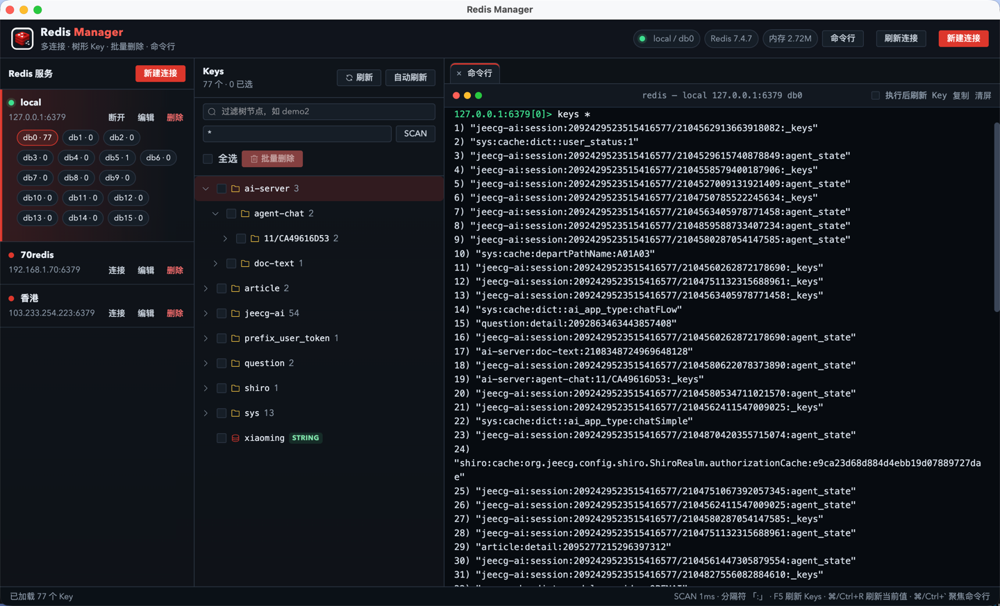
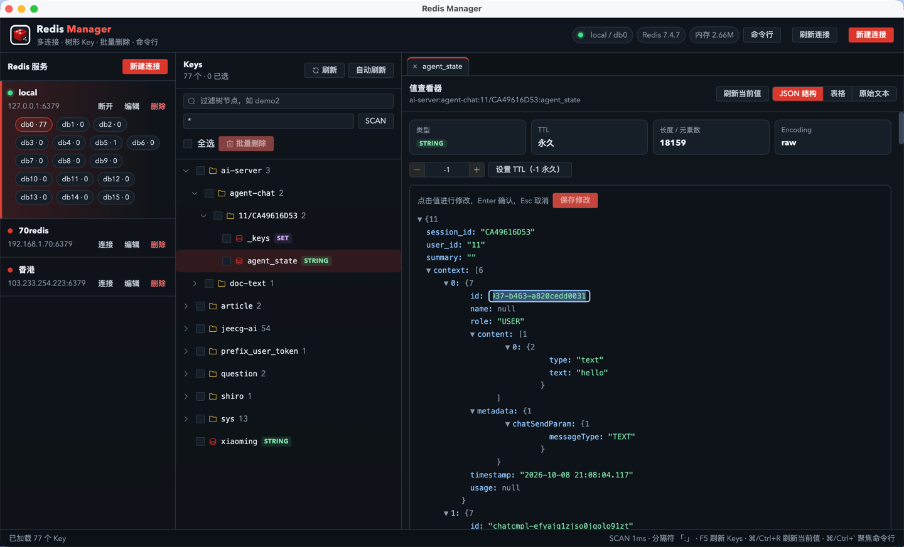

# Redis Manager Desktop

[](https://github.com/jiangshang-dev/redis-manager-desktop/stargazers)
[](./LICENSE)

基于 **Vue 3 + TypeScript + Electron** 的 Redis 桌面客户端。深色界面，Redis 红，用来同时管多台 Redis：树形 Key、命令行、看值、改值。

## 先 Star，再 Clone

这个仓库靠 Star 被看见。

要用它，请先点右上角的 **Star**：[jiangshang-dev/redis-manager-desktop](https://github.com/jiangshang-dev/redis-manager-desktop)。

不打算 Star，就不要 Clone，也不要 Fork。

```bash
# 已经 Star 了再执行
git clone https://github.com/jiangshang-dev/redis-manager-desktop.git
cd redis-manager-desktop
```

## 界面

命令行和 Key 内容都是右侧标签，可以关掉。点顶栏「命令行」打开终端。



JSON 结构里可以直接改值：点一下叶子节点，Enter 确认，再保存回 Redis。



## 功能

- 同时管理多个 Redis，连接保存在本机，密码用系统安全存储加密
- Key 按分隔符（默认 `:`）展开成树，例如 `demo1:demo2:demo3`
- 勾选 Key 或文件夹后批量删除
- 支持 string、hash、list、set、zset、stream、RedisJSON
- JSON 结构、表格、原始文本三种看法
- 修改值：JSON 叶子节点可编辑；hash / list / set / zset 在表格里逐条保存；字符串可整段保存
- 内置终端，直接输入 Redis 命令。`SELECT` 会同步当前库，高风险命令会先确认
- 命令行和内容查看是可关闭标签，关闭按钮在标签左侧
- 刷新连接、数据库、全部 Key、当前文件夹、当前 Key，也可以自动刷新
- 快捷键：`F5` 刷新全部 Key，`⌘/Ctrl + R` 刷新当前值，`⌘/Ctrl + `` ` 打开命令行

## 使用

1. 点「新建连接」，填写 Host、Port、密码。可以先「测试连接」再保存
2. 左侧选中服务并连接，再切换 db0、db1…
3. 中间树按 `namespace:folder:key` 展开，点 Key 会在右侧打开内容标签
4. 勾选节点后点「批量删除」
5. 右侧用 JSON 结构、表格或原始文本查看和修改值
6. 顶栏点「命令行」打开终端。Enter 执行，Shift+Enter 换行，↑ / ↓ 翻历史，`clear` 或 Ctrl+L 清屏

## 开发

```bash
git clone https://github.com/jiangshang-dev/redis-manager-desktop.git
cd redis-manager-desktop
ELECTRON_MIRROR=https://npmmirror.com/mirrors/electron/ npm install
npm run dev
```

## 打包

Mac 上优先打 Mac 包，本机已有 Electron 时会快很多：

```bash
npm run build:mac
```

Windows 包会额外下载 `electron-*-win32-*.zip`。脚本已改走 npmmirror：

```bash
npm run build:win
```

图标：

- `build/icon.png`：Mac / Linux 打包图标
- `build/icon.ico`：Windows / NSIS 安装包图标（`npm run gen:icons` 生成）
- `resources/icon.png`：窗口和 Dock 图标
- `src/renderer/src/assets/logo.png`：界面左上角

## 协议

[MIT](./LICENSE)

如果它帮你少开了一次 redis-cli，回到仓库点一下 Star。
